# OmniHub 功能说明

OmniHub 是一个 macOS 菜单栏工具：截图与贴图、剪贴板历史、暂存文件、正在播放、终端、事项和系统活动，都在菜单栏图标、悬浮球和应用看板（Dashboard）里。下面按功能逐一说明，配有实际界面截图。

## 应用看板（Dashboard）

一个普通窗口，左侧列出全部页面：首页、活动、事项、终端、暂存、剪贴板、设置。从菜单栏图标或程序坞图标打开，打开时显示上次停留的页面，并出现在光标所在的屏幕上。左下角的 **?** 是帮助（⌘?），可以全文搜索。

### 首页

问候语、日期和时间、正在播放、系统概况、接下来的待办和常用操作。

- **正在播放**：封面、歌名、歌词和进度条；点封面或歌名打开对应的播放器。
- **系统**：CPU、内存、磁盘、电池的圆环，下方是实时网速和息屏开关。
- **待办**：接下来的待办，可以直接新建。
- **常用操作**：截图、钉图、终端、剪贴板、暂存、事项。

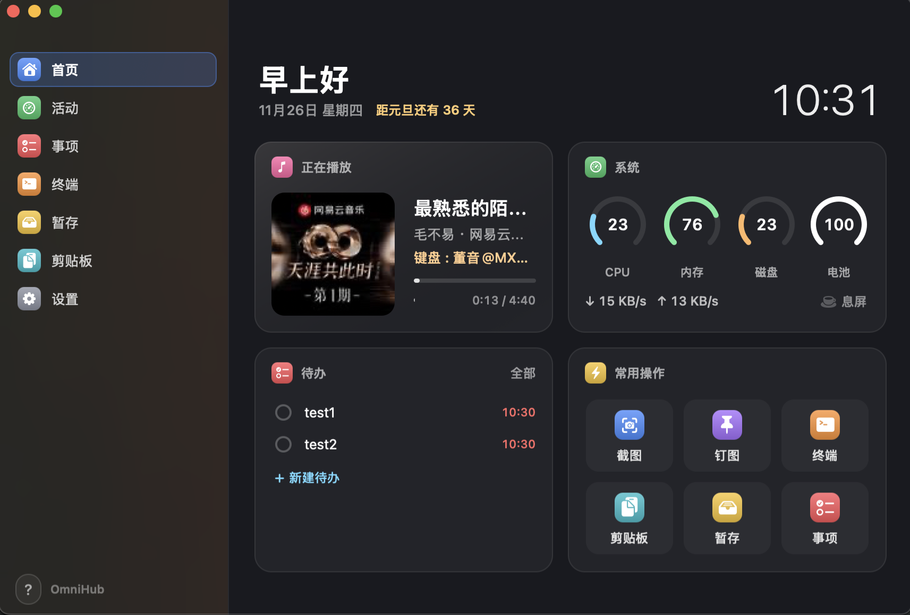

没有待办时：

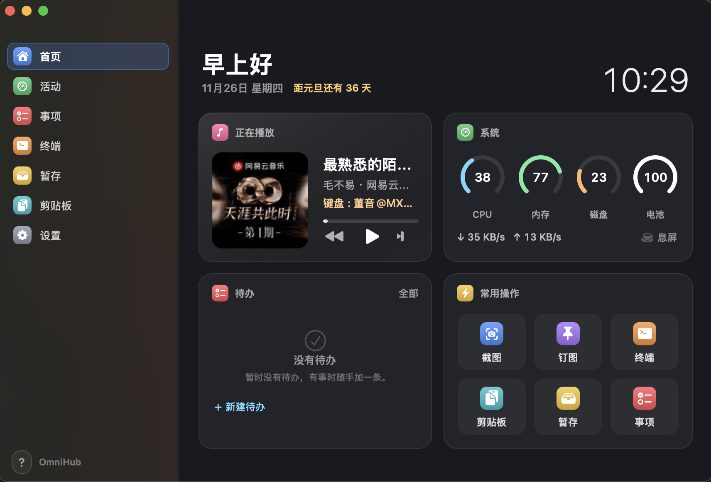

### 活动

CPU、GPU、内存、磁盘、网络的数值和最近的变化曲线，电池详情（健康度、循环次数、温度、功率），按 CPU 或内存排出的占用排行，以及本机 IP 地址。最上面是息屏：默认开启，可以关闭一段时间，让屏幕保持常亮。

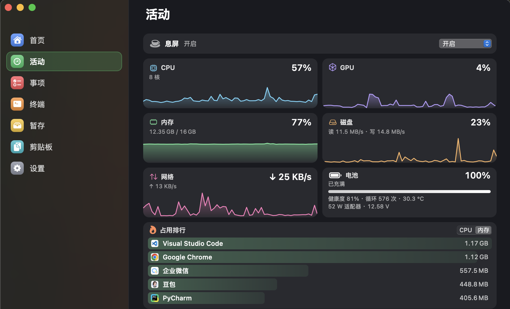

### 终端

多标签终端；可以保存 SSH 和 Telnet 连接一键打开，通过 SFTP 上传和下载文件，支持端口转发和代理。顶部的下载按钮会实时显示传输进度。

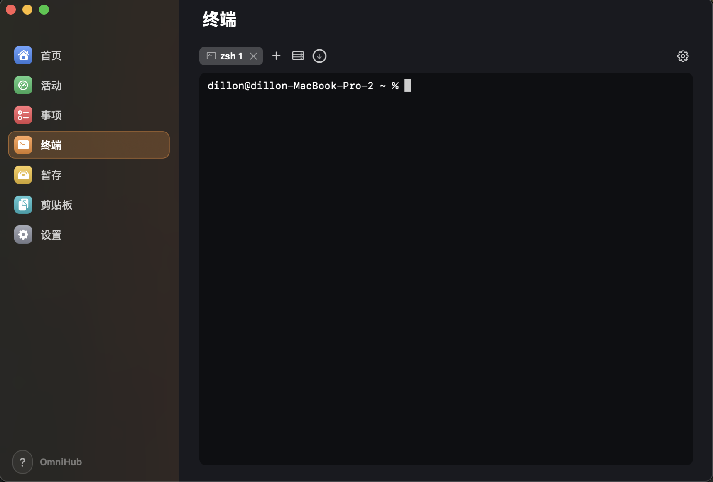

### 暂存

把文件拖到悬浮球上，就会复制一份暂存起来，需要时再拖出去用。到期自动清理，默认保留 7 天。

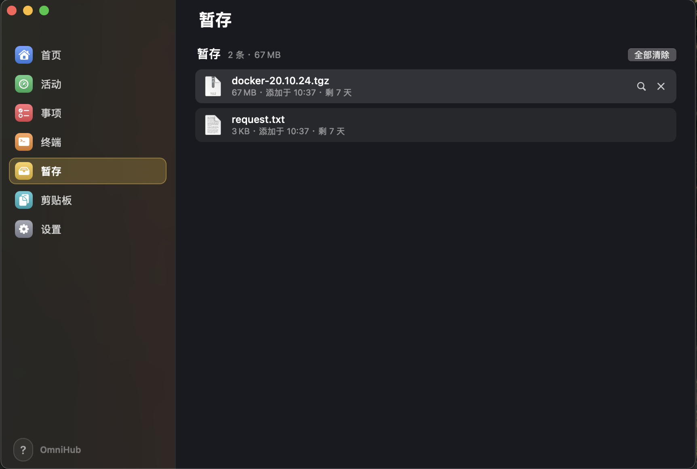

### 剪贴板

记录所有应用复制过的内容，也可以记录图片；可以搜索，收藏的条目不会被清理。双击条目即复制。

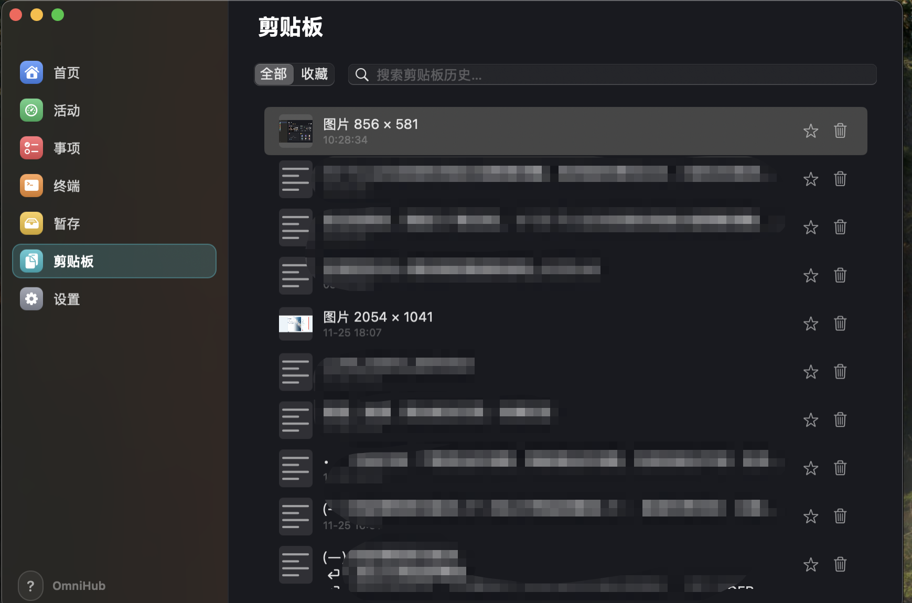

### 设置

先列出所有设置主题，点一个进入，左上角「返回」回到列表。

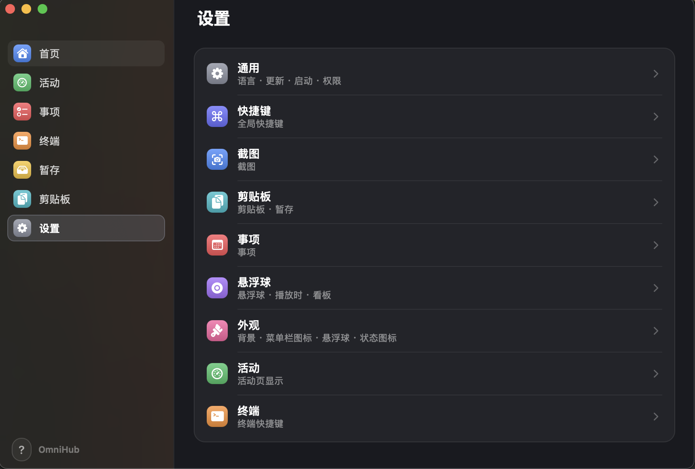

## 截图

按 ⌘1 开始截图。光标移动时自动识别窗口，单击即截取整个窗口；也可以拖出任意区域，确认前还能移动和调整大小。

### 标注与填充

工具栏提供加框（方框或圆框）、箭头、画笔、文字和打码画笔，可以撤销、重做。选中加框后，工具栏下方会展开它的选项：形状、**填充**和颜色。打开「填充」后，画出的框会被颜色填满，直接遮住框里的内容（下图黄色色块盖住了待办列表）。结果可以复制、保存或钉在屏幕上。

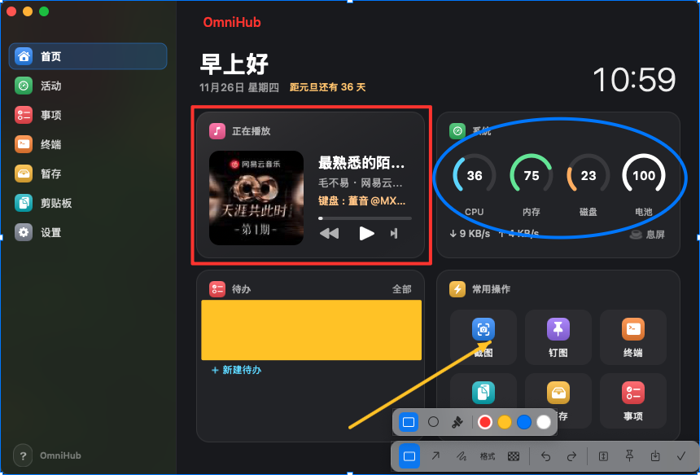

## 菜单栏与状态图标

### 状态图标与网速

菜单栏可以显示小伙伴或状态图标，图标右侧还可以显示网速：上方上传、下方下载，单位为 K/s 或 M/s，固定一位小数。

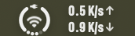

### 信息看板

左键点菜单栏图标，下拉显示正在播放、息屏，以及 CPU、内存、GPU、磁盘、网络、电池的实时卡片，每项都带最近的变化曲线。底部可以进入 Dashboard 或打开设置。右键点图标弹出菜单。

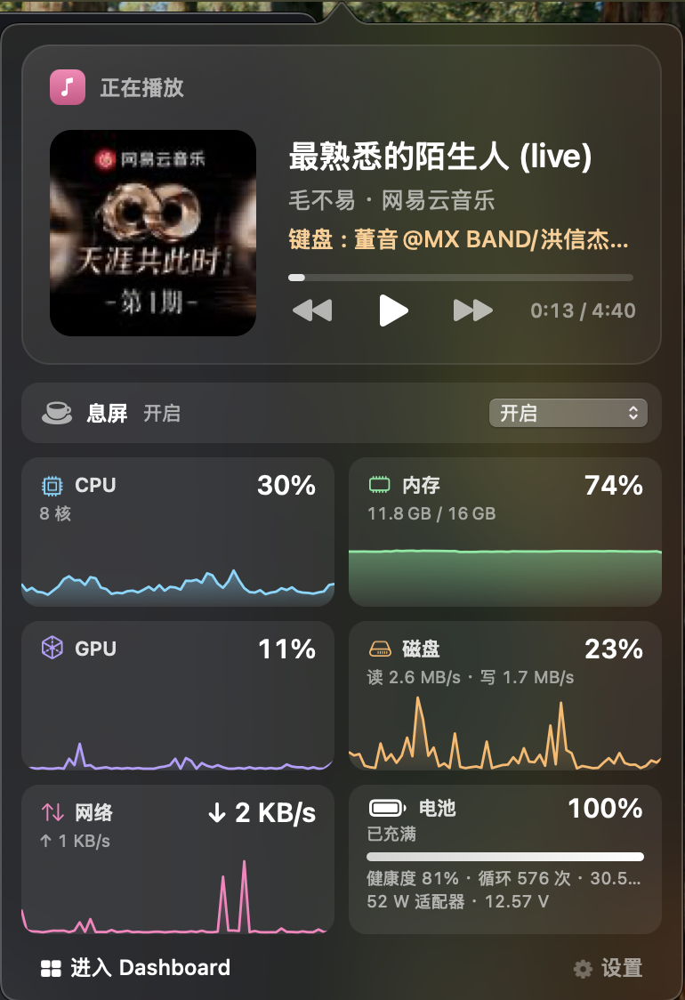

### 状态图标

一个实时的圆形图标：外圈、顶部、中间和底部的圆点分别显示你选的内容（电池、CPU、内存、磁盘、Wi-Fi、网络或音量），可以显示在菜单栏、悬浮球和程序坞上，并可选配色主题。

外圈显示电池时的颜色：用电池时电量 80% 及以上保持默认颜色，往下逐渐变黄、变橙，20% 及以下为红色；只有充电时才是绿色。上排依次为用电池时 76%、15%、8% 和低电量模式（55%）；下排依次为充电中、接着电源但没在充电、已充满、没有电池。

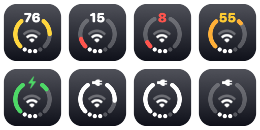

关闭息屏时，顶部数字旁会出现一个小咖啡杯（从左到右：浅色菜单栏、深色菜单栏、充满时、程序坞）：

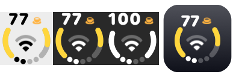

状态图标在「设置 → 外观」里设置，可以实时预览它在菜单栏（浅色和深色）、悬浮球和程序坞上的样子：

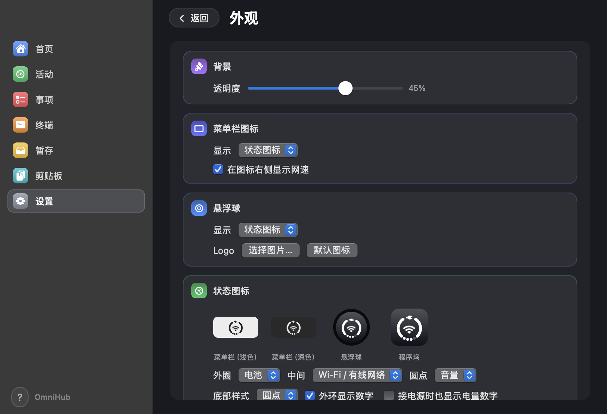
